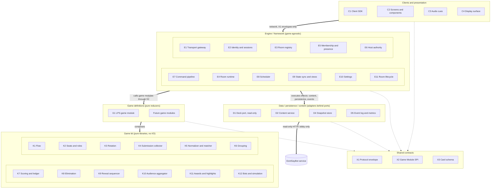
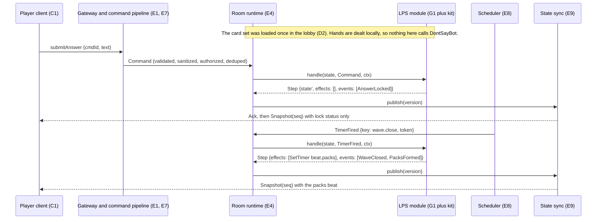
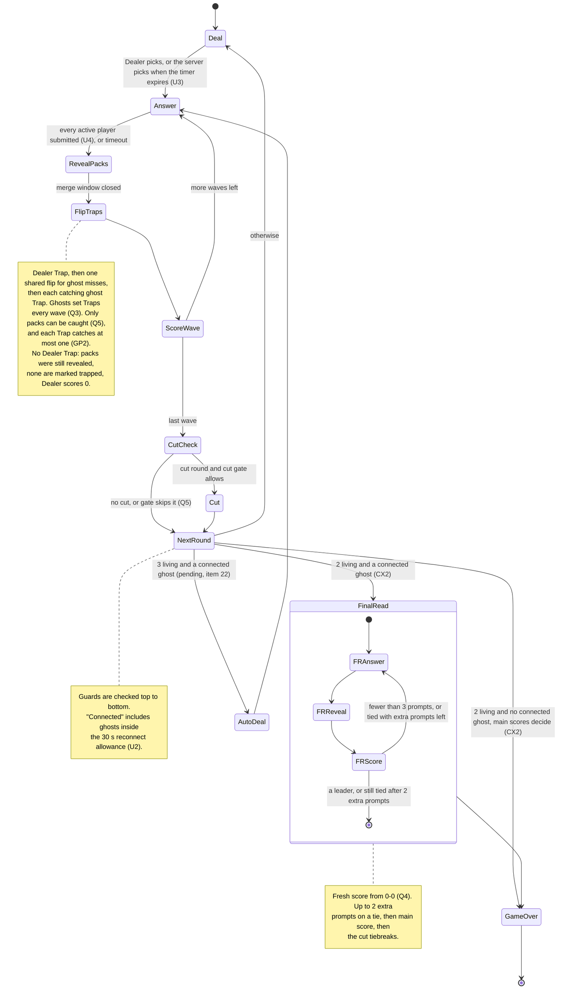
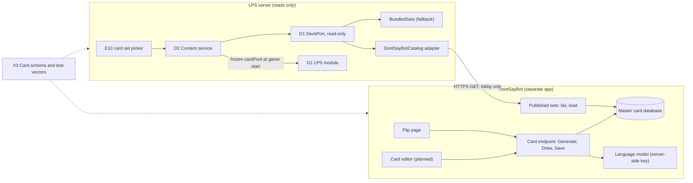

# Don't Say It Network: Module Architecture

**Status:** pre-development design pass (architecture docs only; no engine code yet).  
**Decisions:** tracked in [LastPackStanding/docs/spec-decisions.md](https://github.com/RayeAlerte/LastPackStanding/blob/main/docs/spec-decisions.md). This doc reflects every ruling made on Nov 6, 2026:

- **Q1 (ghosts):** ghosts are cut players and late joiners; viewers are audience and Crowd Trappers only.
- **Q2 (card pick):** the server picks when the pick timer expires (refined by U3).
- **Q3 (ghost Traps):** ghosts set Traps in every wave.
- **Q4 (Final Read):** option A. Start fresh at 0–0, play up to two extra prompts, then the main-game score breaks a tie. Skip the Final Read if there are no ghosts.
- **Q5 (matching and catches):** score-eligible groups, full credit for every Trap, a cut gate, used-up blocking, anchor grouping.
- **Q6 (cards):** DontSayBot owns the card format, the master database, and generation. LPS only *reads* DontSayBot's published card sets and sends nothing back (no aliases). LPS owns how cards are played, arranged, and presented.
- **Q7 (modes):** modular code, one mode with playtest settings.
- **Reveal pacing:** ghost Traps that miss share one flip.
- **Answer-key size:** scales with breadth and waves.
- **Chained grouping:** recorded as a possible future addition only. Live card generation and automatic alias detection in a game are assessed in the log's Future section and are not in scope.
- **Edge-case rulings** (from [edge-case-review.md](https://github.com/RayeAlerte/LastPackStanding/blob/main/docs/edge-case-review.md); details in the log's [Edge-case rulings](https://github.com/RayeAlerte/LastPackStanding/blob/main/docs/spec-decisions.md#edge-case-rulings-decided)):
  - **Presence:** players who leave keep their seats and can rejoin any time (U1). A dropped player has a 30 s reconnect allowance, and no phase ever waits on a disconnected player (U2).
  - **Timing:** the card is picked automatically when its timer expires (U3). A phase advances once every active player has submitted (U4). Only the host changes phase lengths, as playtest settings (U5).
  - **Matching:** a Trap is grouped like an answer and catches at most one group (GP2). A used-up entry is a whole group: root, aliases, and fuzzy matches (GP3). The matcher is designed fresh to handle prefixes, suffixes, and edit distance better than Don't Say It's (GP4). Off-key answers group by spelling count, then lock time (R1). Two answers never share a lock time; the later message is a resubmit.
  - **System:** late answers are accepted only when a mode's tempo calls for it; LPS starts at 0 and measures (S1). Outdated clients are restricted until a refresh, which resumes the same seat (S2). One seed and draw counter per game session, logged for replay (S3). `schemaVersion` sits on each card set and is defined by DontSayBot (S4).
  - **Rules:** the Dealer's answer is only a Trap. Guessers' answers are shown at the reveal; the Dealer's isn't (CX1). Two living players plus a connected ghost start the Final Read; otherwise the game ends on main scores (CX2). A display is a device with no seat, and its owner plays from another device (Q1).
  - **Plan:** LPS's game logic comes first, on bundled sets, and DontSayBot's schema follows (CX3). §14 lists what exists at each point (CX4). Non-English answers are deferred (KG1).
- **Pre-PR1 rulings** ([details](https://github.com/RayeAlerte/LastPackStanding/blob/main/docs/spec-decisions.md#pre-pr1-rulings-decided)): a Dealer Trap is missing only when it was never submitted, and a locked Trap survives a disconnect. With no Trap the Dealer scores 0, the pack reveal still runs, and no pack is marked trapped. Only the played card leaves the pool. A same-time lock is a resubmit, not a silent tie-break. A full award is 10, and the board shows that same number. A pack's points are not split.
- **Reading corrections** ([details](https://github.com/RayeAlerte/LastPackStanding/blob/main/docs/spec-decisions.md#reading-corrections-decided)): a kick throws away a locked unrevealed Trap, and a disconnect does not. Someone who joins after an answer window has closed waits until the next round. Scores show as +10. A ghost does not get +10 for a Trap; that credit stays a count on `ghostCatches`.
- **Two uses of pack** ([details](https://github.com/RayeAlerte/LastPackStanding/blob/main/docs/spec-decisions.md#two-uses-of-pack-decided)): in LPS, a pack is the players who gave the same answer and score for it. In DontSayBot, a pack is a collection of cards, which these docs also call a card set. A card is one prompt.
- **Before a window closes (GP1):** lock status is shown, and ghosts don't see Traps early. Viewers get a live crowd tally in the audience view.
- **Matcher lists and accents (GP4, items 23 and 24):** K5 is built generally, reading its lists as data that's collected during implementation. Accented letters match as plain letters.
- **Accepted proposals:** all 47 edge-case proposals were accepted. Each is recorded in the log's [Accepted proposals](https://github.com/RayeAlerte/LastPackStanding/blob/main/docs/spec-decisions.md#accepted-proposals-edge-case-review), with the decisions it builds on, its modules, and its iteration. §14 lists them by iteration.

All seven top questions and every pre-PR1 edge-case finding are decided. Still open in the log: items 1–20 not yet struck through (4, 7, 8, 15, and 17 are resolved, and item 20's pool sentence is resolved while its small-set warning stays open), and item 22.

**Don't Say It is reference code, not a design baseline.** At most, reusable code segments are taken from it. The DSI citations below show what to avoid or which code may be reused; no LPS rule is derived from DSI's behaviour.  
**Scope:** the reusable modules Last Pack Standing (LPS) needs now, split so that game rules, data structures, session handling, and content never tangle, and so a second mode, scoring rule, audience type, or content source can be added without editing the engine.

---

## 0. Summary

The design has five layers. Each layer may depend only on the layers below it and on the shared contracts:

1. **Engine / framework.** Game-agnostic. Handles rooms, members, sessions, the host, commands, timers, state sync, and settings. It never mentions Dealer, Trap, or pack.
2. **Game kit.** Pure, reusable rule libraries with no I/O: phase flow, seats and roles, rotation, answer collection, matching, grouping, scoring ledger, elimination, reveal beats, audience aggregation, awards, and bots.
3. **Game definition.** LPS itself, written as one *game module* that composes kit pieces behind a single interface (the Game Module SPI). It is a pure reducer: `(state, input, ctx) → (state', effects, events)`.
4. **Data / persistence / content.** The card schema, read-only deck adapters (DontSayBot's published card sets and a bundled fallback), set loading, snapshots, and the event log. The game reaches all of these through *ports*, never directly.
5. **Clients / presentation.** The client SDK, the screen registry, audio cues, and the shared-screen display. Clients see only the protocol and the view models the server projects for them.

| ID | Module | Layer | v1 |
|---|---|---|---|
| E1 | Transport gateway | Engine | Build |
| E2 | Identity and sessions | Engine | Build |
| E3 | Room registry | Engine | Build |
| E4 | Room runtime (per-room actor) | Engine | Build |
| E5 | Membership and presence | Engine | Build |
| E6 | Host authority and moderation | Engine | Build |
| E7 | Command pipeline | Engine | Build |
| E8 | Scheduler (phase timers) | Engine | Build |
| E9 | State sync and view distribution | Engine | Build |
| E10 | Settings | Engine | Build |
| E11 | Room lifecycle (lobby, in game, post game) | Engine | Build |
| K1 | Flow: phases, rounds, waves, beats | Kit | Build |
| K2 | Seats and roles | Kit | Build |
| K3 | Rotation | Kit | Build |
| K4 | Submission collector | Kit | Build |
| K5 | Normalizer and matcher | Kit | Build |
| K6 | Answer grouping | Kit | Build |
| K7 | Scoring pipeline and ledger | Kit | Build |
| K8 | Elimination (cadence, cut, tiebreaks, danger zone) | Kit | Build |
| K9 | Reveal sequencer | Kit | Build |
| K10 | Audience aggregator | Kit | Iteration 5 |
| K11 | Awards and highlights | Kit | Iteration 5 |
| K12 | Bots and simulation harness | Kit (dev-time) | Build early |
| G1 | LPS game module | Game | Build |
| X1 | Protocol envelope | Contract | Build |
| X2 | Game Module SPI (includes the settings schema) | Contract | Build |
| X3 | Card schema and validator | Contract (shared with DontSayBot) | Build a provisional version now; align it with DontSayBot's schema when that's published (CX3) |
| D1 | Deck port and adapters | Data | Bundled sets first; DontSayBot adapter in iteration 4, once DontSayBot's schema exists (CX3) |
| D2 | Content service (set loading, local hand dealing) | Data | Iteration 4; synchronous bundled set before that |
| D3 | ~~Alias outbox~~ | Data | **Removed** (Q6: LPS sends nothing back to DontSayBot) |
| D4 | Room snapshot store | Data | Port only; in-memory in v1 |
| D5 | Event log and metrics | Data | Minimal in v1 |
| C1 | Client SDK | Client | Build |
| C2 | Screen registry and components | Client | Build |
| C3 | Audio cues | Client | Build |
| C4 | Display surface (spectator / shared screen) | Client | Iteration 3 |

The open questions that block design decisions are in [§13](#13-open-questions-spec-gaps-and-conflicts). Each has options and a recommendation in [spec-decisions.md](https://github.com/RayeAlerte/LastPackStanding/blob/main/docs/spec-decisions.md), which also records the rulings. The suggested build order is in [§14](#14-suggested-build-order).

---

## 1. Sources and reference notation

| Short name | Source | Commit | Local checkout |
|---|---|---|---|
| **LPS** | [`LastPackStanding/LPS-Design.md`](https://github.com/RayeAlerte/LastPackStanding/blob/6fcc89211e96ace4203d72d4fa859ed73664d196/LPS-Design.md?plain=1) | `6fcc892` | `/agent/repos/lastpackstanding/LPS-Design.md` |
| **DSB** | [`DontSayBot/README.md`](https://github.com/RayeAlerte/DontSayBot/blob/d4cc8958fbea28b78ca40f83a9e239b38616986b/README.md?plain=1) | `d4cc895` | `/agent/repos/dontsaybot/README.md` |
| **DSI** | [`Don-t-Say-It`](https://github.com/RayeAlerte/Don-t-Say-It/tree/523df4b09860fed2491b6ea8449b68c71d83e3ad) (public; cloned read-only as reference code only, not a design baseline) | `523df4b` | `/agent/repos/dont-say-it/` |

- `LPS §5 L76` means LPS-Design.md section 5, line 76. Append `#L76` to the LPS permalink above to jump to it.
- `DSB L9` means line 9 of the DontSayBot README.
- `DSI main.py L21–33` means that file and line range in the Don't Say It repo at `523df4b`.
- The two private repos each contain only a spec today: LPS has one commit with `LPS-Design.md`, and DontSayBot has one commit with `README.md`. DSI is the only code.

**Interface notation (language-agnostic):** `cmd` is a client-to-server command, `evt` is an event (server to client, or between modules), `fn` is an in-process call, `type` is a data contract, `interface` is a plug-in point. `?` marks an optional field and `[]` a list.

---

## 2. Ground rules for keeping game logic and data structures apart

Each rule targets a specific place where DSI tangles concerns today.

1. **Game state is plain, serializable data.** It holds no sockets, handles, or clocks. *DSI:* `Player` holds the WebSocket next to the score (`Models/game_state.py L7–35`), and `Room` mixes lobby settings, ruleset, round scratch fields, and metrics (`L37–68`).
2. **Every state change goes through the room runtime's single mailbox (E4).** Game code is a pure reducer that receives `now` and a seeded RNG through `ctx`. The RNG's seed and draw counter live in game state, one seed per game session, so a game can be replayed from its log (S3). *DSI:* WebSocket handlers mutate state and spawn timers inline (`main.py L257–275`, `L357–363`).
3. **Kit modules own the data structures; game code calls their operations.** The collector owns submissions, the ledger owns scores, and grouping owns packs. *DSI:* `room.locked_words` and `room.lock_times` are edited by hand in the socket loop (`main.py L320–356`).
4. **The engine never names game concepts, and the game never names transport concepts.** The engine has no notion of Dealer, Trap, or pack. The game sees `memberId` and membership events, never connections.
5. **Redaction happens in exactly one place, the game's** `project()`**.** The engine only ever sends projections. *DSI:* one state object goes to everyone, and secrecy relies on phase checks (`main.py L107–153`).
6. **Rule variants are strategies registered by id, and settings select among them.** For example, `scoring.pack = kMinus1 | flat1`. There are no `if ruleset == …` branches inside rules. *DSI:* `resolve_round` branches on ruleset in the middle of scoring (`logic/round_manager.py L275–296`).
7. **Content arrives through ports.** The game asks for content by emitting effects and never awaits I/O.
8. **One authoritative implementation of matching and scoring lives on the server.** Clients render results. The one allowed exception is the live "used up" hint while typing (Q5 rule 4). If that is confirmed, the browser runs the *same* shared matcher build for hints only, kept identical by the shared test vectors, and the server check on submit stays authoritative. The browser gets only the used-up entries (GP3), never the card's full answer key (R4, accepted). *DSI:* matching and scoring are duplicated on the client by hand (`static/app.js L130–145`, `L430–463`) and kept in sync by convention.

---

## 3. Layers and dependencies



Inside the engine, the main path is E1 → E7 → E4, with E4 driving E8, E9, and the lifecycle. Inside the kit, K6 and K10 build on K5, and K12 drives game modules through X2 exactly as the engine does. Data adapters implement ports defined in the contracts, so the arrow into DATA is runtime execution of effects, not a compile-time dependency of game code.

**Repositories (decided, [Tech stack](https://github.com/RayeAlerte/LastPackStanding/blob/main/docs/spec-decisions.md#tech-stack-decided)).** Each layer lives in its own TypeScript repo, and the repos share versioned packages through GitHub Packages under `@rayealerte`. Changesets publishes them and Dependabot bumps them. Every repo's CI runs the contract test vectors, and `dsi-contracts` keeps a compatibility table of which versions work together.

| Layer | Repo | Modules |
|---|---|---|
| Shared contracts | `dsi-contracts` | X1, X2, a pinned copy of X3, the test vectors, the compatibility table |
| Game kit | `dsi-kit` | K1–K11, plus K12's bot policies |
| Game definition | `lastpackstanding` | G1, plus `LPS-Design.md` |
| Engine | `dsi-engine` | E1–E11 |
| Clients | `dsi-client` (from iteration 2) | C1–C4 |
| Simulation | `dsi-sim` | K12's runner (fake clock, seeded runs, statistics) |
| Card schema source | `dontsaybot` | The card JSON Schema that X3 pins |
| Data | not assigned yet | D1, D2, D4, D5 (an open note in the tech stack; not needed before iteration 2) |

**Forbidden dependencies.** These are enforced through each repo's declared dependencies, which replace the earlier plan for an import-lint rule. `dsi-contracts` depends on nothing. `dsi-kit` and `dsi-engine` depend only on `dsi-contracts`. `lastpackstanding` depends on `dsi-contracts` and `dsi-kit`. `dsi-sim` also depends on the game modules it runs. The table states what each layer must not depend on:

| Layer | Must not import |
|---|---|
| Kit | Engine, Data, Clients, any I/O |
| Game | Engine internals (only X2), Data adapters (only effects and ports), transport, wall clock, global RNG |
| Engine | Any game module by name. Modules are registered by id (`registry.register(lpsModule)`). |
| Data adapters | Game or engine state. They see only queries and cards. |
| Clients | Kit or game code. They render server views. The only exception is the shared matcher build for used-up hints while typing, if that is confirmed (ground rule 8). |

Two of these rules aren't covered by declared dependencies, and both are open notes in the tech stack. First, "no wall clock, global RNG, or I/O" in the kit and game layers: Node globals and built-ins don't appear in a package's dependencies. Second, the client's matcher exception: depending on all of `dsi-kit` would let the client import any rule code.

**One wave end to end.** This shows where each layer participates:



---

## 4. Engine / framework modules

These cover the game-hosting and session concerns: room lifecycle, join, leave, disconnect, reconnect, host transfer, kick, timeouts, and state sync.

### E1 · Transport gateway

- **Does:** terminates WebSocket connections, decodes and encodes X1 envelopes, runs heartbeats, estimates the clock offset, and applies backpressure. It routes each frame to the right room's mailbox and nothing else.
- **Interface:**
  ```
  cmd hello { roomCode, displayName, resumeToken?, clientVersion, joinAs: "player" | "viewer" | "display" }
      // mid-game: player -> ghost, viewer -> audience (Q1); a resumeToken restores the member's own seat (U1)
      // display: a device showing the public view; its owner plays from another device (Q1)
  cmd heartbeat { clientTs }                 -> evt heartbeatAck { clientTs, serverTs }
  evt welcome { memberId, resumeToken, serverTime, serverVersion, restricted: bool }
  evt versionOutdated { serverVersion }      // S2: client stays read-only until the page is refreshed
  fn  send(connectionId, ServerEnvelope)     // used only by E9
  ```
- **Version check (S2):** an incompatible `clientVersion` gets `restricted: true`. The client still receives snapshots but can't send game commands, and it asks the player to refresh. After a refresh, the new client sends the stored `resumeToken` and continues in the same seat. A deploy mid-game sends `versionOutdated` to connected clients.
- **Heartbeats (U2):** frequent enough that a silent connection is noticed well inside the 30 s reconnect allowance.
- **Depends on:** X1, E2, E7. **Must not depend on:** any game module, room state internals.
- **Extends by:** additional transports, such as SSE for the display surface or a Twitch-chat ingest adapter, emit the same `Command` inputs.
- **Serves:** LPS §11 L177 (phones and laptops plus a shared screen). It replaces DSI's name-in-URL socket path (`main.py L203–229`) and the ping/latency pair (`main.py L378–388`; the latency estimate was only needed for word stealing, which LPS cuts, §14 L219).

### E2 · Identity and sessions

- **Does:** issues an opaque `memberId` and a secret `resumeToken` per member per room, validates display names, and resolves reconnects and session replacement by token rather than by name. Tokens stay valid for the whole game and are stored in the browser, so a player can rejoin their seat at any point (U1) and a refresh to update the client continues play (S2).
- **Interface:**
  ```
  type Member  { memberId, displayName, kind: player | viewer | display, joinedAt }
  type Session { memberId, resumeToken, connectionId?, lastSeenAt }
  fn  admit(room, hello) -> Admitted{member, isResume} | Rejected{code: badName | nameTaken | banned | roomFull | roomClosed}
  evt sessionReplaced { memberId }           // sent to the old connection before it closes
  ```
- **Depends on:** the sanitizers (kept from DSI). **Must not depend on:** game state. Name rules are engine policy, but the cap on players per room comes from the game (`maxMembers`).
- **Extends by:** an accounts or OAuth provider (Discord login) can be added later behind the same `admit`.
- **Serves:** LPS §14 L218 (keep rooms, hosts, and sanitizers) and §11 L180 (no strangers in v1, so a lightweight identity is acceptable). It fixes the DSI behaviour where anyone who knows a name can take over that seat (`main.py L175–189`) and where bans are by name only (`main.py L172–173`).

### E3 · Room registry

- **Does:** creates rooms with generated codes, looks them up, closes them, sweeps idle rooms, and (later) assigns rooms to nodes.
- **Interface:**
  ```
  fn  create({ gameId, settings? }) -> roomCode
  fn  lookup(roomCode) -> RoomRef | NotFound
  fn  close(roomCode, reason: idle | hostEnded | error)
  evt roomClosed { roomCode, reason }
  policy { codeLength, alphabet, idleTtl = 300 s, sweepEvery = 60 s, maxRooms }
  ```
- **Depends on:** E4. **Must not depend on:** game rules.
- **Extends by:** a matchmaking or public-listing provider (explicitly not v1, LPS §11 L180) and a sharding provider for multiple nodes.
- **Serves:** keeps DSI's idle sweeper (`main.py L35–47`). It also changes DSI's behaviour of creating a room on the first connect to any code (`main.py L217–218`): today a mistyped code silently creates an empty room.

### E4 · Room runtime (per-room actor)

- **Does:** owns one room's state and processes every input serially: commands, timer fires, membership events, and content arrivals. It calls either the lifecycle (E11) or the active game module (X2), applies the returned effects, bumps the state version, and asks E9 to publish.
- **Interface:**
  ```
  type Input  = Command { memberId, type, payload, cmdId, receivedAt }
              | TimerFired { key, token }
              | MemberEvent { kind: joined | rejoined | presenceChanged | removed | hostChanged, memberId, ... }
              | ContentReady { requestKey, set | error }          // lobby: the chosen card set has loaded
  fn  enqueue(roomCode, Input)               // the only way any room state changes
  type Effect = SetTimer { key, at } | ClearTimer { key }
              | RequestContent { key, query }                    // lobby only: list or load card sets (Q6)
              | Cue { to: ViewClass | all, cue } | Notify { memberId, code, text }
              | EndGame { result }
  ```
- **Depends on:** X2, E8, E9, D2, D5. **Must not depend on:** a specific game module, the transport.
- **Extends by:** new effect types, added to X2 and handled here once, for every game.
- **Serves:** LPS §14 L218 (keep phase timers and the stale-timer guard). It formalizes the guard that DSI hand-codes per phase (`main.py L65–104`). Serial processing also removes interleaving between `await`s in DSI's socket loop.

### E5 · Membership and presence

- **Does:** tracks who is in the room and each member's presence: `connected`, `reconnecting` (dropped less than 30 s ago), or `away`. It turns connection changes into membership events for the game. Leaving never removes a member during a game; only a kick does (U1).
- **Interface:**
  ```
  cmd leave {}                               // marks the member away; their seat stays (U1)
  evt memberJoined       { memberId, kind, during: lobby | game }
  evt memberRejoined     { memberId }        // came back with their token; the game restores their own seat
  evt presenceChanged    { memberId, presence: connected | reconnecting | away }
  evt memberRemoved      { memberId, reason: kicked }
  policy { reconnectAllowance = 30 s (U2; lobby and game), removeOnLeave: false }
  ```
- **Never blocks the game (U2):** presence changes are reported to the game, but no engine timer waits on them. The game decides what presence affects: early advance counts only connected players (U4), and rotation and the Final Read trigger treat `reconnecting` as still present.
- **Depends on:** E2. **Must not depend on:** game roles. The engine reports *that* someone joined during a game. The game decides what that member becomes (in LPS, a ghost).
- **Extends by:** presence policies per member kind (for example, displays hold no seat, so their presence affects nothing).
- **Serves:** LPS §6 L87 (late joiners join as ghosts) and the U1 and U2 rulings. DSI's removal of disconnected players after 120 s (`main.py L476–497`) is deliberately not carried over.

### E6 · Host authority and moderation

- **Does:** treats the host as a *capability* on a member, not a seat. It runs succession, explicit transfer, kick, and ban, and gates host-only commands.
- **Interface:**
  ```
  cmd transferHost { toMemberId }
  cmd kick { memberId, ban: bool }
  evt hostChanged { from?, to, reason: transfer | disconnect | left | kicked }
  fn  isHost(memberId) -> bool
  interface HostSuccession { pick(candidates: Member[], previousHost) -> memberId? }
        // runs only once the host is away, after the 30 s allowance (U2)
        // default: earliest-joined connected player, never a display
        // accepted (KG4): never a viewer either; the original host gets the role back on rejoin
  ```
- **Depends on:** E5. **Must not depend on:** game state. The game may *suggest* succession candidates through a hook if a mode needs it.
- **Extends by:** co-hosts and moderator roles, using the same capability model.
- **Serves:** LPS §14 L221 (the host never hands off on disconnect). Root cause in DSI: `assign_new_host` returns early because the disconnected host is still in `room.players` (`main.py L21–24`, called at `L480–481`). LPS doesn't reuse that code. Succession runs once the host has been away past the 30 s allowance (U2), and the previous host is excluded from the candidates. It also serves host merge (LPS §8 L151) and host settings (LPS §12), and keeps kick-and-ban (DSI `main.py L243–255`).

### E7 · Command pipeline

- **Does:** gives every inbound command the same stages: decode, schema-validate against its `CommandSpec`, run field sanitizers, authorize (host-only? allowed for this seat in this phase?), rate-limit, dedupe by `cmdId`, dispatch. Every command gets exactly one Ack or Reject.
- **Interface:**
  ```
  type CommandSpec { type, payloadSchema, hostOnly?, allowedWhen(state, seat) -> bool, rateClass }
  type Reject { cmdId, code: invalid | forbidden | wrongPhase | duplicate | rateLimited | outdatedClient | late | rule, ruleCode?, message }
        // outdatedClient: game commands from a restricted client (S2); late: arrived after the window plus the mode's grace (S1)
  fn  registerCommands(gameId, CommandSpec[])
  ```
- **Depends on:** X1, X2, E6, the sanitizers. **Must not depend on:** rule internals. `allowedWhen` is supplied by the game.
- **Extends by:** each game module registers its own command specs, and sanitizers register by field type (`gameWord`, `prompt`).
- **Serves:** LPS §14 L218 (keep sanitizers) and L220 (one-answer-per-wave guard; its enforcement is in K4). It replaces DSI's single bag-of-optional-fields payload (`Models/payloads.py L4–15`) and reuses its sanitizers (`logic/round_manager.py L23–58`) and ping rate limit (`L73–85`).

### E8 · Scheduler (phase timers)

- **Does:** holds named timers per room and delivers `TimerFired` into the room's mailbox. Each `SetTimer` returns a token, and E4 drops any fire whose token is no longer current. That is the stale-timer guard, generalized.
- **Interface:**
  ```
  fn set(roomCode, key, at) -> token
  fn clear(roomCode, key)
  fn pause(roomCode) / resume(roomCode)      // shifts every deadline; for a later host pause
  interface Clock { now() }                  // real clock, or a fake one for tests and simulation
  ```
- **Depends on:** Clock. **Must not depend on:** phase names. Keys are opaque strings chosen by the game.
- **Extends by:** pause/resume, and "early close" (the game clears the timer itself once every active player has submitted, U4).
- **Serves:** LPS §3 L42 (about 10 s answer window), §12 L187 (wave length 5–30 s), §14 L218 (stale-timer guard); DSI `main.py L65–104`.

### E9 · State sync and view distribution

- **Does:** after each version bump, asks the active module for one projection per *view class* and sends a `Snapshot` to every member in that class, plus a small per-member overlay (own answer, own Trap). It sends a full snapshot on reconnect. Deadlines go out as absolute server times, which clients correct with the E1 clock offset.
- **Interface:**
  ```
  type ViewerKey { viewClass, memberId? }
  evt  Snapshot { seq, serverTime, lobby: LobbyView, game?: ViewModel }
  evt  Cue { seq, cue }                      // beat-aligned sound and animation triggers
  fn   publish(roomCode, version)
  // later: evt Patch { seq, baseSeq, ops[] }
  ```
- **Depends on:** X2 (`project`, `viewClasses`), E1. **Must not depend on:** the meaning of any field. It never inspects the view.
- **Extends by:** new view classes declared by a game. Each class is computed once and fanned out, which is what lets large audiences scale.
- **Serves:** LPS §1 L16 (answers face up), §10 L167 (reveals in steps), §11 L178 (the spectator view never shows the Trap), §11 L179 (stream-safe Dealer). It replaces DSI's single broadcast to every player (`main.py L107–153`) and its integer `time_left` countdown (`L119`).

### E10 · Settings

- **Does:** keeps a typed, schema-driven settings document per room: defaults, ranges, enums, and computed "Auto" values. It validates changes (host only, lobby only unless a field says otherwise) and resolves the effective settings for the current roster.
- **Interface:**
  ```
  type Field { key, type: int | duration | enum | bool | text | cardSet, default, range? | options?,
               auto?: (roster) -> value, mutableIn: lobby | always, hostOnly: true,
               stage: playtest | stable }   // Q7: playtest levers can be retired without code changes
  type SettingsSchema = Field[]               // declared by the game module (X2)
  cmd  updateSettings { patch }
  evt  settingsChanged { settings, effective }
  fn   resolve(settings, roster) -> EffectiveSettings
  ```
- **Depends on:** X2. **Must not depend on:** rule code. The game reads `EffectiveSettings` and never raw form input.
- **Extends by:** a new setting is one schema entry, and the lobby UI (C2) renders it automatically.
- **Phase lengths (U5):** every timed phase and reveal step reads its length from a `duration` field with `hostOnly: true`, `mutableIn: lobby`, and `stage: playtest`. Which phases get a field, and their defaults and ranges, will be defined later. Placeholders are 10 s for the card pick and 10 s for the answer window. Late-answer grace isn't a host setting; it's a timing value of the game mode (S1, X2).
- **Other accepted fields:** a playtest toggle for showing the live crowd tally on the display, off by default (GP1). Stream-safe can change at any time, the Crowd Trap at round boundaries, and everything else only in the lobby (GP14).
- **Card set picker (Q6):** the §12 "Theme" setting is a `cardSet` field. Its options are DontSayBot's published sets, listed through D2, with the bundled sets as a fallback. The host can't type a new theme in LPS, so new themes are made as sets in DontSayBot beforehand.
- **Serves:** LPS §12 L182–192 (the full settings table) and §5 L76 (Auto cut cadence). It replaces DSI's hand-coded `set_timers` and `set_ruleset` handlers (`main.py L417–449`).

### E11 · Room lifecycle

- **Does:** owns the room-level state machine. The lobby is an engine concept; the game module owns everything from "starting" to "post game."
- **Interface:**
  ```
  states: Lobby -> Starting -> InGame -> PostGame -> (Lobby | InGame) ; any -> Closed
  cmd startGame {}        // host; checks the game's minMembers and maxMembers(settings)
  cmd endGame {}          // host; aborts to PostGame
  cmd playAgain {}        // host; new game with the same room, members, and settings
  cmd returnToLobby {}
  evt lifecycleChanged { state }
  ```
- **Depends on:** E5, E6, E10, X2. **Must not depend on:** game phases.
- **Extends by:** a game picker in the lobby, once there is more than one module. Per Q7, that waits until LPS's rules are locked; v1 has no picker.
- **Serves:** keeps DSI's start, play-again, and return-to-lobby (`main.py L451–470`) but moves the `"lobby"` value out of the game's phase field (`Models/game_state.py L50`). The end of a game is driven by the module's `EndGame` effect (LPS §6 L93–96).

---

## 5. Game kit modules

The kit holds the duplicatable resource modules: rounds, turns, timers, roles, audiences, scoring, matching, reveals, and awards. Every kit module is a pure library that takes state in and returns state out, with no clock and no RNG except through `ctx`. Game modules compose them.

### K1 · Flow (phases, rounds, waves, beats)

- **Does:** a declarative phase graph with nested counters (round, wave, beat). It emits `SetTimer` and `ClearTimer` automatically on phase entry and exit, and increments a `phaseInstance` counter that E8 tokens key on.
- **Interface:**
  ```
  type FlowState { phaseId, phaseInstance, round, wave, beat?, deadline? }
  interface PhaseSpec<S> {
    id
    duration(S, settings) -> Duration         // required: every phase is finite; lengths come from host playtest settings (U5)
    onEnter(S, ctx) -> Step
    completeWhen?(S) -> bool                 // early advance once every active (connected, eligible) player has submitted (U4)
    onTimeout(S, ctx) -> Step
    next(S) -> phaseId
  }
  fn advance(flow, specs, S, ctx) -> Step
  ```
- **No phase waits on a person (U2, U5):** presence never pauses a phase. A host action, such as closing the merge window, can only end a phase early. The Deal phase's `onTimeout` is the only path to the server's card pick (U3).
- **Depends on:** nothing. **Must not depend on:** E8 directly. It returns effects instead.
- **Extends by:** new phases are new `PhaseSpec`s. Sub-flows are phase groups with their own counters. For example, the Final Read loop runs three prompts plus up to two extra on a tie, and is skipped when no ghosts are connected (Q4).
- **Serves:** LPS §3 L39–47 (round steps), L49–56 (waves), §6 L90–96 (endgame and Final Read), §10 L167 (stepped reveals).

### K2 · Seats and roles

- **Does:** keeps the game-level roster, separate from engine membership. Each member maps to at most one *seat*. A seat has a *kind* (persistent, such as living or ghost) and per-round *roles* (such as Dealer). Kinds declare capabilities that other modules query. Seats persist for the whole game: a member who leaves keeps their seat and gets it back on rejoining (U1). Display devices have no seat (Q1).
- **Interface:**
  ```
  type Seat { seatId, memberId, kind, status: connected | reconnecting | away, sinceRound, flags{} }
        // status mirrors E5 presence (U2); "active" in a phase = connected and eligible (U4)
  interface SeatKind {
    id
    answersIn(waveCtx) -> bool
    answerRole: pack | trap | crowd | none
    scores: bool
    viewClass
  }
  type RoleAssignment { round, role, seatId }
  fn transition(seat, toKind, reason) -> Seat
  ```
- **Depends on:** nothing. **Must not depend on:** engine `Member` fields beyond `memberId`.
- **Extends by:** new seat kinds (for example, a moderated audience). See [§9](#9-duplicatable-resources-how-to-add-a-new-thing).
- **Serves:** LPS §2 L29 (Dealer), L33 (Ghost), L34 (Crowd Trap), §6 L85–88, §11 L178. It replaces DSI's `role` string, `active` or `audience` (`Models/game_state.py L15`).

### K3 · Rotation

- **Does:** keeps a turn queue over eligible seats. It skips `away` seats, which keep their place for when they rejoin (U1), treats `reconnecting` seats as present, re-queues finished ones, and drops seats that are no longer eligible, such as cut players.
- **Interface:**
  ```
  type RotationState { queue: seatId[], current? }
  fn start(eligible, rng) -> RotationState            // shuffled with the session seed (S3)
  fn next(rot, eligible) -> RotationState | Exhausted
  ```
- **Serves:** LPS §2 L29 ("the seat rotates"), §14 L218 (keep Dealer rotation), §6 L91 (nobody deals in the endgame; the game simply stops calling `next`). DSI's rotation code (`logic/round_manager.py L154–161`, `L400–443`) may be reused as a code segment; the rules here are LPS's own.

### K4 · Submission collector

- **Does:** opens an answer window for a set of eligible seats and accepts at most N submissions per seat. It records server lock times, runs pluggable guards, and reports who is missing at close.
- **Interface:**
  ```
  type Window { windowId, eligible: seatId[], maxPerSeat = 1, opensAt, closesAt, lateGraceMs }
        // lateGraceMs: the mode's timing value (S1); 0 in LPS until playtest data says otherwise
  type Submission { seatId, raw, clean, lockedAt, windowId }   // lockedAt = server receive time
  interface Guard { check(clean, seatId, ctx) -> ok | ruleCode }   // e.g. notUsedUp, nonEmpty
  fn submit(window, seatId, raw, now, guards[]) -> Accepted | Rejected{ruleCode | late | sameTime}
  fn allSubmitted(window, connected: seatId[]) -> bool   // U4: every connected eligible seat has submitted
  fn close(window) -> { submissions[], missing: seatId[], lateArrivals[] }   // lateArrivals feed D5 (S1)
  ```
- **Same-time locks are a resubmit.** Individual locks only: guessers, the Dealer, ghosts, and Final Read answers. If a submission would record the same server receive time as one already locked, the earlier message wins. While the window is still open, the later seat is rejected with `sameTime`, told to submit a new word, and stays unlocked. That attempt does not use their one submission, and it is not treated as a missed window. The audience bulk window is not part of this. Its tie stays the earliest submission (KG6).
- **A joiner after a closed window waits.** They are not added to the window that already closed, and they do not answer a later wave of that round. They become eligible at the next round. A join during an open window is still U14: eligible at the next window, not this one. A join during the Final Read is still audience until the game ends (U14).
- **A locked Trap survives a disconnect.** Dropping a seat never removes a submission it already locked. The Dealer has no Trap only when they never locked one. A kick throws away a locked unrevealed Trap (U12). A disconnect does not.
- **Used-up blocking (Q5 rule 4, GP3):** `notUsedUp` runs on every player answer window: living players, the Dealer, and ghosts. It covers revealed Traps too. It does *not* run on the audience's bulk window. A used-up entry is a whole group: the root, its aliases, and the fuzzy-matched answers, or an off-key anchor and its variants. The guard blocks any answer that would join a used-up group (it asks K6), not just repeated text. A live hint while typing is pending (see ground rule 8).
- **Depends on:** K5 (for the `notUsedUp` guard), the sanitizers. **Must not depend on:** scoring.
- **Extends by:** new guards, bulk mode for audience windows (no per-submission broadcast), and editable-until-close windows if a mode wants them.
- **Serves:** LPS §3 L42 (simultaneous answers; ghosts are eligible in every wave's window per [Q3](https://github.com/RayeAlerte/LastPackStanding/blob/main/docs/spec-decisions.md#q3--when-ghosts-set-traps-decided)), §3 L55 (Dealer Trap can't be used up), §5 L80 (lock timestamps are the tiebreak), §14 L220 (one-answer-per-wave guard), and L223 (removing word stealing removes DSI's second-lock escape from the Trap).

### K5 · Normalizer and matcher

- **Does:** the single authoritative answer-equality service, designed fresh rather than ported (GP4). It normalizes, strips known prefixes and folds known suffixes, looks up the current card's aliases, compares by edit distance, then applies host merges. It returns *why* two answers matched and *how close* they came.
- **Interface:**
  ```
  fn normalize(raw) -> key                               // case, punctuation, spacing; accented letters -> plain (item 24); Latin alphabet in v1 (KG1)
  type AffixRules = { prefixes[], suffixes[] }           // e.g. leading "the/a/an"; trailing "s/es/'s"; data, not code (GP4, item 23)
  type RootIndex  = [{ rootId, rank, text, aliases[] }]  // one root per answer-key entry (Q5 rule 5)
  type AliasIndex = Map<normalizedAlias, rootId>         // derived from RootIndex
  type MergeSet                                          // host merges; union-find per prompt; never saved back (Q6)
  type Thresholds = [{ maxLen, maxDist }]                // length-based; an adjacent-letter swap counts as one edit; values set by the X3 vectors
  type MatchResult { matched, via: exact | affix | alias | fuzzy | merge | none, distance, allowed, nearMiss }
  fn match(a, b, { aliases, merges, thresholds }) -> MatchResult
  fn matchRoot(answer, roots: RootIndex, thresholds) -> { rootId, result } | none
  ```
- **Stays pairwise:** K5 only answers "do these two match, and how closely?" It never decides group membership. Grouping rules live in K6's swappable `GroupingStrategy`, which is what keeps chained grouping (a possible future addition) out of the matcher.
- **Depends on:** nothing. **Must not depend on:** card I/O. It receives a `RootIndex`, not a deck.
- **Built generally; lists are data (GP4, item 23):** K5 reads its prefix list, suffix list, thresholds, and known false pairs as inputs. They're collected and tuned during implementation and playtests without code changes. Matching folds accented letters to plain ones, while answers are displayed as typed (item 24).
- **"Better than Don't Say It" is defined by the test vectors (GP4):** the X3 vectors pin the current lists and thresholds. They include cases DSI gets wrong ("dog"/"dogs", "The Beatles"/"Beatles") and false pairs that must not match ("horse"/"house").
- **Extends by:** alternative normalizers, such as other scripts once they compare meaningfully (KG1, Future), and threshold or affix tables per mode. `nearMiss` (distance equals allowed + 1) powers highlights.
- **Serves:** LPS §8 L148–152 as overridden by GP4, and §10 L171 ("one letter from disaster"). DSI's edit-distance routine (`logic/round_manager.py L125–137`) may be reused as code, but not its thresholds or `squash_word` rules. The client mirror (`static/app.js L130–145`) is retired.

### K6 · Answer grouping

- **Does:** clusters a wave's guesser answers into groups using a grouping strategy built on K5. The Dealer's answer is never grouped; it's only a Trap (CX1). K6 applies host merges, marks which groups are *score-eligible*, and finds the one group a given Trap lands in.
- **Interface:**
  ```
  type Group { groupId, rootId?, anchor, display, seats: seatId[], variants: raw[] }
  interface GroupingStrategy  { id, group(subs[], roots: RootIndex, matcher, ctx) -> Group[] }
  interface ScoreEligibility  { id, eligible(group, ctx) -> bool }
  fn merge(groups, groupA, groupB) -> Group[]
  fn assign(text, groups, roots, matcher) -> groupId | none          // where an answer or Trap would land
  fn hits(trapText, groups, eligibility, matcher) -> groupId | none  // one-to-one (GP2): assign(), then eligible only
  fn wouldJoinUsedUp(text, usedUp: Group[], matcher) -> bool          // the notUsedUp guard (GP3)
  // v1 registrations: GroupingStrategy "anchor"; ScoreEligibility "packsOnly" (size >= 2)
  ```
- **Anchor grouping, the only v1 strategy (Q5 rule 5):**
  - Each answer-key entry is a root, made of its text plus its alias set. A typed answer joins the root it matches (`matchRoot`).
  - Answers that match no root group around an anchor of their own, ordered by spelling and lock time (R1). Normalized spellings are processed from most common to least, ties going to the earliest lock. Locked answers never share a lock time, because a same-time attempt is rejected and that player submits again (K4). Each joins the closest existing anchor it matches, the earlier one on a tie, or starts a new anchor. A group is displayed under its most common raw spelling.
  - **Traps use the same path (GP2):** a Trap lands in at most one group and catches it only if that group is score-eligible. Several Traps can land on the same group.
  - An answer joins a group only by matching its anchor or root, never another member, so A≈B and B≈C never pull in C.
  - Host merges join two groups.
- **Score-eligible groups (Q5 rule 1):** only eligible groups can be trapped or score. LPS uses `packsOnly`, so a lone answer matching a Trap stays lone, with no credit. Future modes can widen eligibility, for example letting individual players earn points for not being caught. That doesn't apply to LPS.
- **Future (not in scope):** a `chained` strategy, where an answer joins if it matches *any* member, is recorded as a possible later addition. It plugs in as another `GroupingStrategy` with no change to K5 or K7.
- **Serves:** LPS §2 L27–28 (pack, lone answer), §3 L43–44 (packs, then the flip), §8 L151 (host merge), §10 L165–166 (packs as the centerpiece, lone answers as a footnote).

### K7 · Scoring pipeline and ledger

- **Does:** separates scoring *rules* from the score *data*. Rules turn an outcome into deltas. Modifiers adjust deltas, for example the wave multiplier. An append-only ledger stores every delta with its reason and can answer totals, per-round breakdowns, and standings. Scores live on named *tracks*, so non-point counters (ghost catches) and separate contests (the Final Read) reuse the same ledger.
- **Score base is 10, and the board shows that number.** A full award is 10 in the ledger and +10 on the screen. Nothing is stored as a fraction, and nothing is stored as 10 and shown as 1. The wave multiplier scales the 10. Each player receives their own full award; a pack's points are not divided across its members. `ghostCatches` stays a count of players toward best ghost. A ghost is not awarded +10 for a Trap. The Dealer still gets +10 per player caught. A missing Dealer Trap writes no `dealerCatch` delta, which shows as 0.
- **Interface:**
  ```
  type ScoringInput { round, wave, multiplier, eligibleGroups, otherGroups, traps: [{ setterSeat?, setterKind, hitGroups }], dealer? }
  interface ScoringRule { id, track, score(input, settings) -> Delta[] }
  interface Modifier    { id, apply(delta, input) -> Delta }
  type Delta  { seatId, track, points, ruleId, reason, round, wave }   // point tracks: the integer stored is the integer shown
  type Ledger { append(Delta[]); total(seat, track); breakdown(round); standings(track, filter) }
  ```
- **LPS registrations** (these are the numbers stored and shown):
  - `packMates` ((*k* − 1) × 10) or `packFlat` (+10), awarded in full to each member
  - `dealerCatch` (+10 per player caught, then × the wave multiplier; the Dealer's only source of points while dealing, CX1). No locked Trap means this rule writes nothing.
  - `ghostCatch` (track `ghostCatches`, not points; one per player caught toward best ghost, never +10. Credited per wave, since ghosts set Traps every wave per Q3)
  - `finalReadEcho` (track `finalRead`, which starts fresh at 0–0 with no carry-over from the main game; +10 per matching ghost; Q4)
  - modifier `waveMultiplier` (×*w*) or `flat`, applied to the point total that is shown
- **Full credit for every Trap (Q5 rule 2):** when several Traps hit one pack, each setter gets full credit: the Dealer shows +10 × multiplier per caught player, and each ghost is credited with every player they caught on `ghostCatches`, not as points. The pack scores 0 once. Crowd Trap catches have no individual setter and are recorded as a crowd stat.
- **Serves:** LPS §4 L60–72, §3 L53 (×*w*), §6 L95 (Final Read), §12 L189 (scoring setting), §15 L227 (a later +2 partner bonus is just another rule). It replaces DSI's single `resolve_round`, which mixes vote tallying, flags, scoring, and metrics (`logic/round_manager.py L220–398`).

### K8 · Elimination

- **Does:** decides *whether* this round cuts, *who* is cut, how ties break, and who is in the danger zone. Each piece is a replaceable strategy.
- **Interface:**
  ```
  interface CutCadence { isCutRound(roundIdx, livingCount, settings) -> bool }
  interface CutGate    { check(standings, cutIndex, ctx) -> allow | skip{reason} }   // Q5 rule 3
  interface CutSelector { select(standings, ctx) -> seatId[] }          // default: lowest total
  type Tiebreaker = (tied: seatId[], ctx) -> seatId[]                    // narrows the tied set
  chain: [ loneBeforeCaught, lastLockGoesFirst, seededRandom ]
  fn dangerZone(standings, margin) -> seatId[]
  ```
- **Cut gate (Q5 rule 3):** "No cuts after a tied first round, or when fewer than half of the board has points." LPS registers two gates:
  - `noCutOnTiedFirstCut`: skip if the game's first cut check finds two or more living players sharing the lowest total.
  - `minScoredShare(0.5)`: skip if fewer than half the *living players* (the board) have more than 0 stored points.

  Two details are pending in the log: whether "first round" means the first cut check, and whether a skipped cut is deferred, with a proposed cap of two skips in a row.
- **Danger zone (KG3):** the players who would be cut, plus anyone within two full awards of them. That margin is 20, shown and stored.
- **Final Read tie (Q4, CX2):** if the finalists are still tied after the two extra prompts, or the game ends at two living players because no ghost is connected, the same chain decides the winner. It starts with a `mainScoreFirst` tiebreaker (higher main-game total wins) and then runs the cut tiebreaks.
- **Serves:** LPS §5 L76 (cadence and Auto), L77 (lowest is cut), L78–80 (tiebreak order), L81 (danger zone), §13 L201 (about two cut-line ties per game).

### K9 · Reveal sequencer

- **Does:** turns an outcome into an ordered list of *beats*, each with a duration, an optional host skip, and an optional wait. It runs them as a sub-phase of K1 so the phones and the shared screen show the same beat at the same moment. Each beat can emit a `Cue` effect.
- **Interface:**
  ```
  type Beat { id, kind, ref, duration, hostCanSkip?, waitFor?: hostMerge | none, cue? }
  fn plan(outcome, settings) -> Beat[]
  // LPS, every wave: packs (guessers only, CX1) -> (merge window) -> dealerTrap -> ghostMisses (one shared flip)
  //                  -> catching ghostTrap x n -> crowdTrap? -> scores and danger zone
  // each Trap catches at most one group (GP2); every beat has a finite duration (U5)
  // no Dealer Trap: the pack reveal still runs, the dealer beat shows no Trap, and no pack is marked trapped
  // after the last wave only: -> cut | noCutThisRound (cut gate, Q5 rule 3)
  ```
- **The merge window (KG5, accepted):** a short beat right after the packs appear and before any Trap flips. In it, the host can merge two groups that mean the same thing (LPS §8 L151) or split off a member who joined only by fuzzy match (GP5).
  - Changes last for the current prompt only (K5 `MergeSet`) and are never sent to DontSayBot.
  - It ends before the first flip, because once Traps are visible a merge or split could move a pack into or out of a Trap's reach.
  - Its length is a host playtest setting (U5), and the host can close it early.
  - Every merge is labeled "merged by host" on all screens. A host who is also a guesser may merge a group they're in.
- **No Dealer Trap:** the pack reveal is not skipped. Packs flip and are shown, and none of them is marked trapped because of the Dealer. The Dealer Trap beat still plays, with no Trap to show, and the Dealer's score for the wave is 0. Ghost Traps in that wave still flip.
- **Flips (P5, accepted):** one flip per caught pack, naming every Trap and setter that caught it. The shared flip of misses shows their text (GP3 follow-on). The cut beat states its reason (GP13).
- **Pacing rule:** ghost Traps flip every wave (Q3), so without grouping, flips per round rise from *waves + ghosts* to *waves × (1 + ghosts)*.
  - **Decided:** ghost Traps that catch nothing share one flip.
  - **Proposed, still pending:** identical ghost Traps also share one flip that names every setter, and the order is Dealer, then the misses, then each catching ghost Trap.
- **Serves:** LPS §3 L43–44, §10 L167 (reveals in steps), §1 L18 (easy to watch), §10 L169 (sounds tied to caught pack, clean pack, and cut).

### K10 · Audience aggregator

- **Does:** collects bulk answers from a crowd window and reduces them to one or a few aggregate results. It is built for scale: bucket answers by normalized key in O(n), then fuzzy-merge only the top K buckets.
- **Interface:**
  ```
  fn collect(window, seatId, raw)                 // K4 bulk mode, rate-limited
  interface Aggregation { id, reduce(subs[], matcher, policy) -> Result }
  // LPS: mostCommon -> { answer, count, share } | none
  policy { minParticipants = 3, tieBreak: earliestFirstSubmission }   // KG6, accepted
  fn liveTally(window, blocklist) -> [{ answer, count }]               // GP1: shown to the audience view while the window is open
  ```
- **Inputs (Q1):** viewers, as audience, only. Ghosts never feed it. It runs only when the Crowd Trap is on.
- **Live tally (GP1):** viewers watch the crowd's answers converge while the window is open. The tally passes the same blocklist as Crowd Trap candidates (P3). It appears in the audience view only, unless the host's playtest toggle puts it on the display.
- **Used-up audience answers:** these aren't blocked at input (Q5 rule 4). The proposal, pending in the log, is to drop them before counting so the Crowd Trap never lands on a dead answer. Whether the Crowd Trap flips every wave is also pending.
- **Serves:** LPS §6 L88 (Crowd Trap) and §12 L191 (Crowd Trap On/Off). Future aggregations, such as audience polls, plug in as new `Aggregation`s.

### K11 · Awards and highlights

- **Does:** computes end-of-game awards and in-game highlights from the domain event log, never from live rule code.
- **Interface:**
  ```
  interface AwardDef          { id, title, compute(events[], finalState) -> Winner[] }
  interface HighlightDetector { id, onEvent(evt, acc) -> Highlight? }
  ```
- **LPS registrations:** awards for most caught, closest call, biggest pack, and best ghost; highlights for "one letter from disaster" and pack of the night.
- **Serves:** LPS §4 L70 (best ghost), §10 L170–173.

### K12 · Bots and simulation harness (dev-time)

- **Does:** runs any game module headlessly with a fake clock, a seeded RNG, and bot policies, at full speed, and reports statistics. It drives the same X2 interface the engine uses, so a simulation is the real rules.
- **Interface:**
  ```
  interface BotPolicy { id, act(view: ViewModel, rng) -> Command? }   // friendsSync, joker, reader, afk
  fn simulate(module, settings, bots[], seed, games) -> Stats
  ```
- **Serves:** LPS §13 L196–202 (seeded simulation drives tuning) and §16 L235–237 (the scoring, wave, and breadth questions need repeatable runs). It replaces DSI's `tools/simulate_lobbies.py`, which reaches into `Room` fields directly.

---

## 6. Game definition layer: G1 · LPS game module

- **Does:** Last Pack Standing and only that. It composes K1–K11 and declares LPS's seat kinds, phases, commands, settings schema, scoring rules, cut strategies, beat plan, projection rules, and awards.
- **Interface (implements X2):**
  ```
  interface GameModule {
    id = "lps", version
    settingsSchema                       // LPS §12
    commands: CommandSpec[]
    minMembers, maxMembers(settings)
    seatKinds, viewClasses(state)
    timing { lateAnswerGraceMs }         // S1: per-mode tempo value, not a host setting; LPS = 0 until measured
    init(settings, roster, ctx) -> Step  // ctx.rng is seeded per game session; seed and draw count live in state (S3)
    handle(state, input, ctx) -> Step
    project(state, viewer) -> ViewModel
  }
  // LPS commands
  cmd pickCard     { cardId }                   // Dealer, Deal phase; the server picks only when the timer expires (Q2, U3)
  cmd submitAnswer { text }                     // living, ghost (every wave, per Q3), finalists; used-up blocked (Q5)
  cmd crowdAnswer  { text }                     // audience (viewers), bulk path, only when Crowd Trap is on (Q1)
  cmd mergeGroups  { groupA, groupB }           // host, merge window; lasts for this prompt only, never sent to DontSayBot (Q6)
  cmd advanceBeat  {}                           // host, if a beat allows skipping
  ```
- **State (plain data):**
  - `flow`, `seats`, `rotation`;
  - `cardPool` (the playable cards from the card set loaded in the lobby, minus the ones already played; unchosen cards from a hand are back in the pool);
  - `hand` (three candidate cards drawn from `cardPool`), `card`;
  - `window`, `usedUp[]` (whole groups: root, aliases, and fuzzy-matched variants, GP3), `groups`, `traps[]`;
  - `ledger`, `cutHistory[]`, `finalRead { prompt, extra }`;
  - `rng { seed, draws }` for this game session, logged so the deals can be replayed (S3).
- **Seat kinds (Q1):**
  - `living`. In each prompt, one living player is the Dealer, whose answer is only the Trap (CX1). The others are *guessers*, whose answers form packs and lone answers.
  - `ghost`: cut players and late joiners who join to play. They answer and set a Trap in every wave, per Q3. A ghost who joins after an answer window has closed does not answer that window or a later wave of that round; they wait until the next round. A join during an open window waits for the next window (U14). A join during the Final Read is audience until the game ends (U14).
  - `audience`: viewers. They are Crowd Trappers when the Crowd Trap is on, and otherwise only watch. They never set individual Traps or score. This kind was renamed from `audienceGhost`.

  `display` is not a seat kind. It's a device that shows the public view and takes no game input. Someone whose computer is the shared screen joins it as the display and plays from another device, as in Jackbox (Q1). Seats persist when their member leaves and are restored on rejoin (U1).

  The proposed cap on late-joiner ghosts, with overflow seated as audience, is pending.
- **View classes:** `public`, the same data that `display` receives (never shows any Trap before its flip beat); `living`; `dealer`, which hides its own Trap after lock when stream-safe is on; `ghost`; `audience`; plus a per-seat overlay for the member's own answer. At the packs reveal, every class sees the guessers' answers face up. The Dealer's answer stays hidden until the Trap flips (CX1).
- **Before a window closes (GP1):** every class sees lock status, and each member sees their own answer. Nobody sees another member's answer or Trap. Ghosts never see the Dealer's or other ghosts' Traps before the flip. Only the Dealer sees the three-card hand. The `audience` class also gets a live crowd tally, filtered by the blocklist (P3). It reaches `public` and the display only if the host turns on that playtest toggle, since living players could otherwise dodge the Crowd Trap. Projection tests cover every class.
- **Must not depend on:** sockets, HTTP, DontSayBot, wall-clock time, global random.



**Spec coverage:** §3 round and waves (L39–56), §4 scoring (L60–72), §5 cut (L76–81), §6 ghosts, endgame, and Final Read (L85–96), §8 matching (L148–152), §10 presentation (L165–173 via projection, K9, and K11), §11 platform modes (L177–179 via view classes), §12 settings (L184–192). Decisions applied here:

- Q1 overrides §2 L33 and §6 L88: viewers are audience, not ghosts.
- Q3 overrides §3 L42 and L54 and §6 L86: ghosts are in `Answer` and `FlipTraps` every wave.
- Q2 and U3: the Deal phase falls back to a server pick when its timer expires.
- U4: `Answer` ends early once every active player has submitted.
- CX1 refines §1 L16, §2 L27–28, and §3 L43: only guessers' answers form packs and are shown at `RevealPacks`.
- Q5 rule 3: `CutCheck` runs the cut gate.
- [Q4](https://github.com/RayeAlerte/LastPackStanding/blob/main/docs/spec-decisions.md#q4--the-final-read-decided) and [CX2](https://github.com/RayeAlerte/LastPackStanding/blob/main/docs/spec-decisions.md#cx2--final-read-trigger-decided) refine §6 L93–96: the Final Read starts fresh, caps extra prompts at two, and falls back to main score. It runs only when two living players remain and a ghost is connected; otherwise the game ends on main scores.

`AutoDeal` stands for "nobody deals" (§6 L91). Whether that stage stays at three living players is pending (item 22). Who picks the card there and in the Final Read is also pending; the proposal is that the server deals a hand and picks from it.

---

## 7. Data, persistence, and content

### X3 · Card schema and validator (shared contract with DontSayBot)

- **Does:** the one definition of a prompt card, kept as a language-neutral JSON Schema plus a test-vector file that both repos run in CI. The vectors cover normalize and match cases, root and alias grouping, and alias collisions. There are two validation levels: *shape*, for any consumer, and *LPS-playable*, for LPS's rules.
- **Ownership (Q6, S4):** DontSayBot owns the card shape, the master card database, card generation, and any review of generated cards. DontSayBot also defines `schemaVersion` (`major.minor`), which every card set it serves declares ([DontSayBot #1](https://github.com/RayeAlerte/DontSayBot/pull/1)). LPS pins a major version and only reads published sets. LPS owns `validatePlayable` and every rule about how cards are played, arranged into hands, and presented.
- **Provisional until DontSayBot's schema lands (CX3):** LPS's game logic comes first. Until DontSayBot publishes its schema, X3 is a provisional LPS-side copy: DontSayBot's card format (DSB L32–45) wrapped in a set that carries `schemaVersion`. LPS's needs (the playability rules, the answer-key minimums, the version) are written down as the expectations DontSayBot's schema should meet.
- **Interface:**
  ```
  type CardSet { schemaVersion, setId, theme, version, adult, cards: Card[] }
        // DontSayBot's pack: a collection of cards, not an LPS answer pack.
        // schemaVersion lives on the pack, not the card (S4).
        // adult: boolean, default false. Missing means false. 18+ does not mean explicit.
  type Card { id, topic, prompt, breadth: narrow | medium | broad,
              answers: [{ text, aliases[] }],     // the answer key; ordered most obvious first; each entry is a root (Q5)
              theme, source: curated | generated, adult, tags[] }
        // adult: same flag as the pack. Missing means false.
  fn acceptSet(set, pinnedMajor) -> ok | rejected{reason}    // same major: accept, ignore unknown fields; other major: reject (S4)
  fn validateShape(card) -> issues[]                         // DontSayBot-owned schema
  fn validatePlayable(card, { waves }) -> issues[]           // LPS-owned
     // answers.length >= minAnswers(breadth, waves); obvious #1 and crowded #2-#5;
     // no alias collisions after normalize; prompt <= 200 chars
  fn minAnswers(breadth, waves) -> int                       // answer-key size scales with breadth and waves
  ```
- **Answer-key size (decided):** more answers are needed for broader cards, and multi-wave ghost Traps use answers up. The starting numbers (proposed: narrow 5, medium 8, broad 12, plus 3 per extra wave) and how to treat very short narrow keys are pending in the log.
- **Matcher test vectors (GP4):** the same file holds the K5 vectors: prefix and suffix tables, distance thresholds, cases that must match, and false pairs that must not. They're new, written against the GP4 ruling rather than ported from DSI's tests.
- **Serves:** LPS §7 L104–126 and L130 (an obvious #1 and a crowded #2 to #5); DSB L30–48 (the same format, duplicated today in both repos). The 200-character prompt cap is an LPS limit.

### D1 · Deck port and adapters (read-only)

- **Does:** the only way content enters the game server. Per Q6 it is **read-only**: LPS lists and loads DontSayBot's published card sets and never writes back. Adapters are interchangeable and compose into a fallback chain.
- **Interface:**
  ```
  type CardSetInfo { setId, theme, version, cardCounts: { narrow, medium, broad } }
  type CardSet     { schemaVersion, setId, theme, version, adult, cards: Card[] }   // see X3; this is DontSayBot's pack
  interface DeckPort {
    listSets() -> CardSetInfo[]
    loadSet(setId) -> CardSet
  }
  adapters: DontSayBotCatalog (HTTPS GET, timeout, retry, validate with X3)
            BundledSets (versioned JSON exports of DontSayBot sets, shipped with LPS)
            FallbackChain(primary, fallback)
  ```
- **Must not depend on:** game state, the language model (generation stays inside DontSayBot), or any write path to DontSayBot.
- **Order of work (CX3):** `BundledSets` comes first and carries the game through iteration 3. `DontSayBotCatalog` is built once DontSayBot has published its schema and set API. Item 6 in the log is LPS's proposal for that API.
- **On load (S4):** `acceptSet` checks the major version. A missing `adult` on the pack or on a card is stored as false. Card text has control characters stripped and length caps applied, and is always rendered as plain text. Cards are keyed `setId:cardId`, so a top-up from another set can't collide.
- **Serves:** LPS §9 L158 (DontSayBot deck with bundled fallback) and DSB L10 (Draw from the database). DontSayBot's Generate (DSB L9) and Save (DSB L11) stay internal to DontSayBot and are no longer called by LPS (Q6). Prompts from DSI's `prompts.txt` can serve as raw material for the first bundled set. Its answer lists still need ranking, aliases, and breadths added by hand, since none of its content is taken as a baseline.

### D2 · Content service (set loading and local dealing)

- **Does:** runs the lobby's `RequestContent` effects off the room's mailbox and returns `ContentReady`. Those effects list sets for the picker and load the set the host chose. At game start it filters the set with `validatePlayable` for the final settings and gives the game a frozen `cardPool`. From then on, the game's `HandPolicy` deals every hand locally. There are no DontSayBot calls during a game and no prefetch.
- **Interface:**
  ```
  type ContentQuery { key, kind: listSets | loadSet, setId? }
  interface HandPolicy {                        // game-supplied (LPS owns arrangement, Q6)
    breadthsFor(livingCount, settings) -> Breadth[3]
    playable(card, settings) -> bool            // validatePlayable with the room's wave count
    deal(cardPool, livingCount, settings, rng) -> Card[3]
  }
  policy { loadTimeout, onFailure: bundledSets,
           minPlayable ~ 20 (below that: warn the host, top up from the bundled default set) }
  ```
- **Frozen per game:** the set is copied into game state at start, so an edit in DontSayBot can't change a running game.
- **Answer-key size:** ghost Traps become used-up answers every wave (Q3), so multi-wave rounds use up a card's answers sooner. `playable` keeps only cards that meet `minAnswers(breadth, waves)`.
- **Card use (decided):** only the played card leaves `cardPool`. The other cards in the hand return, including when the server picks on timer expiry (U3). While the hand is being chosen it is out of the pool, so the same card cannot be dealt twice at once.
- **Server pick (Q2, U3):** when the pick timer expires, the game picks from the current hand, with no fetch.
- **Seeded dealing (S3):** `deal` draws with the session's `ctx.rng`, and every draw advances the logged draw counter, so a game's hands can be replayed from its log.
- **Serves:** LPS §3 L41 (three cards of differing breadth), §7 L132–133 (breadth scales with table size; per-tier ceiling), and §9 L158. The mid-round requests in §9 L160 are replaced by loading in the lobby (Q6), so a game never waits on DontSayBot or a language model.

### D3 · Alias outbox (removed)

- **Removed by Q6:** LPS sends nothing back to DontSayBot. Host merges live only in the current prompt's `MergeSet` (K5). The id is kept so D4 and D5 keep theirs. Richer aliases are a DontSayBot-side job, built when a set is created (see the log's Future section).

### D4 · Room snapshot store

- **Does:** a port for saving and restoring a room's serialized state. v1 uses an in-memory adapter. A later Redis-style adapter would let rooms survive a server restart or move between nodes. Ground rule 1 (state is plain data) is what keeps this possible.

### D5 · Event log and metrics

- **Does:** an append-only log of domain events per game (`AnswerLocked`, `PacksFormed`, `TrapHit`, `PlayerCut`, and so on) plus guardrail counters. The log feeds K11 awards, highlights, simulation comparisons, and debugging.
- **Replay (S3):** each game session logs its seed, the card set's id and version, and the draw counter, so its deals and server picks can be replayed.
- **Latency evidence (S1):** logs round-trip times per connection, and every submission that arrives after its window closes, with how late it was. Playtests use this to decide each mode's `lateAnswerGraceMs`.
- **Serves:** LPS §10 L173 and §13. It replaces DSI's `logic/metrics.py`; the idea of per-guardrail counters is worth keeping.

---

## 8. Clients and presentation

### C1 · Client SDK

- Handles `hello` and resume with a `resumeToken` kept in browser storage, sends commands with `cmdId`s, matches Acks and Rejects, tracks snapshot `seq`, estimates clock offset from heartbeats, reconnects with backoff, and renders countdowns from absolute deadlines.
- **Rejoin and refresh (U1, S2):** a player can close the tab and come back to the same seat at any point in the game. When the server marks the client outdated, it goes read-only and shows "Refresh to update". After the refresh, the stored token resumes play in the same seat.
- **Serves:** replaces DSI's manual "Rejoin & Sync" button (`static/app.js L154–211`) with token-based resume.

### C2 · Screen registry and components

- Screens are pure functions of the view model. A registry resolves `(surface, lifecycle, phase, beat, seatKind) → Screen`, so a new phase or seat kind adds a screen without editing a central switch.
- Reusable components: PackBoard, LoneLine, UsedUpList (greyed), TimerBar, Scoreboard, DangerZone, CardHand (three cards), AnswerInput, HostControls (merge, skip), PlayerList, Toasts.
- The lobby settings form is generated from the X2 settings schema. All copy lives in a strings table.
- **Serves:** LPS §10 L165–168 and §11 L178. It replaces DSI's single `renderState` function that switches on phase (`static/app.js L213–550`).

### C3 · Audio cues

- Maps cue ids (`tick`, `caughtPack`, `cleanPack`, `cut`, and so on) to assets. Sounds are triggered by server `Cue`s aligned to beats, not by client guesswork, and can be muted per surface.
- **Serves:** LPS §10 L169 ("Fix that first"). In DSI the three audio tags point at `src="."` (`index.html L13–15`).

### C4 · Display surface

- A shared-screen client (TV, stream, projector) that joins as `display`, receives the `public` view class, uses large type, and has no game input.
- **A device, not a player (Q1):** the display holds no seat and is never the host. When someone's computer is the shared screen, that computer joins as the display, and its owner plays or hosts from a second device such as a phone, as in Jackbox.
- **Serves:** LPS §11 L177–178 and §1 L18.

---

## 9. Duplicatable resources: how to add a new thing

| To add… | Plug in at | Touches | Example from the specs |
|---|---|---|---|
| **A game mode** | A new `GameModule` (X2) registered by id | Its own folder: phases (K1), seat kinds (K2), rules (K7, K8), beats (K9), projection, settings schema, screens (C2) | One mode in v1 (LPS §1 L19). Per Q7, other modes come after LPS is locked in |
| **A grouping rule** | `GroupingStrategy` in K6 | Game registration; K5 unchanged | v1 has `anchor` only. Chained grouping is a possible future addition, not in scope |
| **A way to be score-eligible** | `ScoreEligibility` in K6 | Game registration; K7 rules read eligibility | LPS: packs only. Future: individual players earning points for not being caught (Q5) |
| **A cut gate** | `CutGate` in K8 | Game | No cut after a tied first cut, or when fewer than half the living players have points (Q5) |
| **A scoring rule** | `ScoringRule` or `Modifier` in K7, selected by a settings enum | Settings schema entry plus a rule file | Flat +1 vs *k* − 1 (LPS §4 L72); secret partner read +2 (LPS §15 L227) |
| **A phase or timer** | `PhaseSpec` in K1 and a duration setting in E10 | Game module | Merge window; Snipe betting phase (LPS §15 L228) |
| **A reveal step** | Beat kind in K9 plus a screen in C2 | Game and client | Crowd Trap flip beat |
| **An audience or guest type** | `SeatKind` in K2, a view class in E9, optionally an `Aggregation` in K10 | Game, E5 presence policy | Audience and Crowd Trappers (LPS §6 L88, Q1); later a moderated audience |
| **A cut or tiebreak rule** | `CutCadence`, `CutSelector`, or `Tiebreaker` in K8 | Game | Auto cadence (LPS §5 L76) |
| **A content source or DontSayBot pack** | A read-only `DeckPort` adapter (D1), or a bundled card-set export validated by X3 | Data layer only | A DontSayBot pack is a collection of cards, not an LPS answer pack. Published packs, bundled packs, a print-and-play export (LPS §15 L229) |
| **A screen or menu** | Registry entry in C2 | Client only | Spectator big-type screens |
| **An award or highlight** | `AwardDef` or `HighlightDetector` in K11 | Game registration | "Sam was reading you!" reveal (LPS §15 L227) |
| **A host setting** | One `Field` in the game's settings schema, tagged `playtest` or `stable` (Q7) | Game; UI is generated | Every row of LPS §12; the proposed wave-multiplier playtest lever |

**Worked check against the later features (LPS §15):**

- **Secret partner read** needs per-seat secret state (a K2 seat flag, exposed only in that seat's projection overlay), one `ScoringRule` (+2), and one `AwardDef`. No engine change.
- **Snipe** needs one `PhaseSpec` or beat, one command (`snipeBet`), and one `ScoringRule`. No engine change.
- **Print-and-play** is a deck export from DontSayBot, which uses X3. No LPS change.
- **Chained grouping** (possible future addition, recorded in the decision log) is one more `GroupingStrategy` in K6. It would be selectable as a playtest setting or used by a later mode. No change to K5, K7, or the engine.
- **Live card generation** (assessed, not in scope) needs no LPS change if it happens as reviewed draft sets inside DontSayBot. The new sets simply appear in the E10 card set picker.
- **Suggested alias merges** (assessed, not in scope) would add one beat in K9, one host command, and a new suggestion port. That port would be a second external dependency, which is why it stays out of v1.

---

## 10. DontSayBot integration boundary



- **Order of work (CX3):** DontSayBot's schema will be defined soon, but LPS's game logic is built first so that both sides align on what a card set must provide. Until then, LPS runs on bundled sets in the provisional X3 format. LPS's needs are written down as expectations for DontSayBot's schema: the playability rules, the answer-key minimums, and a set-level `schemaVersion`. The `schemaVersion` requirement is now in DontSayBot's README ([DontSayBot #1](https://github.com/RayeAlerte/DontSayBot/pull/1)).
- **What crosses the boundary:** published card sets in the X3 format, read through two calls (list sets, load a set). **Nothing goes the other way:** no generation requests, no aliases, no play data. The exact API shape is a pending confirmation in the log (item 6). LPS never sees the language model, its prompt template, or the API key (DSB L13).
- **Direction and timing:** one-way, from the LPS server only, and only in the lobby. Player browsers never talk to DontSayBot, and a running game makes no DontSayBot calls.
- **Failure policy:** if DontSayBot can't be reached from the lobby, the picker offers the bundled sets. Every card is checked with X3 and `validatePlayable` before the game starts, because DSB-side validation alone isn't enough to trust.
- **Flip** stays a DontSayBot page (LPS §9 L161) and does not use the LPS engine. It shares only X3. A networked Flip, if ever wanted, would become a game module on this engine.
- **Flip parallel work (DontSayBot):** Flip (`flip/` + `card-packs/`) is developed in DontSayBot in parallel as the content path for LPS packs. Pack schema changes for that path: each pack JSON carries `schemaVersion`; `adult` is boolean and defaults to false when missing; packs live as JSON files under `card-packs/`; Flip loads them through `card-packs/index.json`. Ghosts stay on the non-point `ghostCatches` track — that ruling is closed.
- **Ownership (Q6, decided):**
  - "DontSayBot owns the card format and the master card set database. LPS owns the rules for how DSB's card sets are played, arranged and presented."
  - "LPS is only consuming from DSB and is not providing return feedback like Aliases. The cards are generated on DSB, but LPS chooses from the card sets DSB already created."
  - The X3 shape schema, the master set, generation, and any review of generated cards live in DontSayBot. LPS pins a schema version and ships its bundled fallback as an export of DontSayBot sets.
  - LPS owns `validatePlayable` (including the answer-key minimums that DontSayBot's sets must meet), `HandPolicy`, and presentation.
  - The duplicate format in LPS §7 L104–121 becomes a reference to DSB L32–45.
- **Not in scope (assessed in the log's Future section):** live card generation during a game, and automatic alias detection. The routes that keep this boundary are both DontSayBot-side: draft sets reviewed in the card editor before publishing, and richer alias sets built when a set is created.

---

## 11. Scaling notes

- **Rooms are actors.** One room is processed serially on one node, and rooms shard by code across nodes. Gateways stay stateless and route by room code. v1 can run all of this in a single process.
- **Fan-out is per view class, not per member.** Projection cost is constant per class, so 500 audience members cost the same projection as one.
- **The audience input path is bulk.** It is rate-limited, aggregated by K10, and never broadcast per submission. Viewers get no per-member overlays beyond "locked."
- **Content loads before the game.** D2 runs off the room loop and only in the lobby. A running game makes no content calls, so DontSayBot's speed or availability can't stall it.
- **Determinism makes the sim and tests cheap.** Pure modules plus a seeded `ctx` mean K12 can run thousands of games per minute against the production rules.

---

## 12. Reuse map from Don't Say It (code segments only)

Don't Say It is not a design baseline (standing rule in the decision log). This table lists only code that may be lifted as a segment, and DSI behaviour that is deliberately dropped. No LPS rule comes from DSI's behaviour. It follows the keep, cut, add, and fix lists in LPS §14 L218–221, as amended by the rulings.

| DSI piece | Where | Goes to | Action |
|---|---|---|---|
| Rooms and host, kick and ban | `main.py L21–33`, `L243–255` | E3, E6 | Rewrite on member ids. DSI's host handoff is broken; succession follows U2 and E6 |
| Phase timers and the stale-timer guard | `main.py L65–104` | E8 plus K1 | Reuse the guard idea; generalize to keys and tokens |
| Dealer rotation with purge skip | `logic/round_manager.py L154–161`, `L400–443` | K3 | Code segment at most; rotation rules are LPS's own (away seats keep their place, U1) |
| `levenshtein` | `logic/round_manager.py L125–137` | K5 | Code segment only. `squash_word` and the `is_match` thresholds are replaced by the new matcher (GP4); retire the client mirror |
| Sanitizers, ping rate limit | `logic/round_manager.py L23–58`, `L73–85` | E7 | Code segments; character rules follow KG1 |
| Lock timestamps | `main.py L353–355` | K4 | Recording idea only; lock time is server receive time (S1) |
| Late joiner becomes audience | `main.py L191–199` | E5 plus G1 seat kinds | Not kept: late joiners who join to play become ghosts (Q1) |
| Disconnect purge (120 s) and idle sweep (300 s) | `main.py L476–497`, `L35–47` | E5, E3 | Purge **dropped**: seats persist and players can rejoin (U1), with a 30 s reconnect allowance (U2). The idle-sweep idea may be reused |
| Metrics counters | `logic/metrics.py` | D5 | Keep the idea |
| Simulation harness | `tools/simulate_lobbies.py` | K12 | Rewrite against X2 |
| Tribunal, Decoy, Bounty, Mind Reader, rulesets | `logic/round_manager.py L163–398`, `main.py L277–289`, `L365–377`, `L390–426` | none | **Cut** (LPS §14 L219) |
| Word stealing and latency compensation | `main.py L315–356`, `L384–388` | none | **Cut** (LPS §14 L219, L223). Late-answer grace is set per mode from measurements (S1) |
| `prompts.txt` | repo root | First bundled set (provisional, CX3) | Raw prompt material only; ranking, aliases, and breadth added by hand |
| Audio tags with `src="."` | `index.html L13–15` | C3 | **Fix first** (LPS §10 L169) |

---

## 13. Open questions, spec gaps, and conflicts

The top questions, Q1–Q7, are tracked in [spec-decisions.md](https://github.com/RayeAlerte/LastPackStanding/blob/main/docs/spec-decisions.md). That log holds the user's wording, my interpretations, the spec lines each ruling overrides, and a **Remaining confirmations** list of smaller follow-ups, each with a recommendation. Status as of Nov 6, 2026:

| Q | Question | Status | Where it lands in this doc |
|---|---|---|---|
| Q1 | Who is a ghost? The spec's definitions of viewer, ghost, and late joiner conflicted (§2 L33, §6 L87–88). | **Decided:** ghosts are cut players and late joiners; viewers are audience and Crowd Trappers only. | E1 `joinAs`, G1 seat kinds, K10 inputs |
| Q2 | What happens when the Dealer doesn't pick a card (§3 L41)? | **Decided:** the server picks when the pick timer expires (U3). The pick time is a host playtest setting (U5). A missing Dealer Trap is only the case where none was submitted, the pack reveal still runs, and the Dealer scores 0. *Pending:* who picks in no-Dealer phases. | G1 diagram (Deal), D2, K7, K9 |
| Q3 | Ghost Traps only in the last wave (§3 L54) vs. ghosts setting every Trap in the endgame (§6 L91). | **Decided:** ghosts set Traps every wave. Overrides §3 L42 and L54 and §6 L86. | K4, K7, K9, G1, D2, §14 |
| Q4 | Does the Final Read start fresh, and how does its tie loop end (§6 L93–96)? | **Decided:** option A. Fresh start at 0–0, up to two extra prompts, then main score, then the cut tiebreaks. Skipped if there are no ghosts. [Details](https://github.com/RayeAlerte/LastPackStanding/blob/main/docs/spec-decisions.md#q4--the-final-read-decided). | K1 loop, K7 `finalRead` track, K8 `mainScoreFirst`, G1 diagram |
| Q5 | Matching and catch edge cases. | **Decided:** score-eligible groups only, full credit for every Trap, the cut gate, used-up blocking for players but not the audience, and anchor grouping. Chained grouping is a possible future addition. | K4, K5, K6, K7, K8, K9, ground rule 8 |
| Q6 | The DontSayBot contract and who owns the card format. | **Decided:** DontSayBot owns the format, master set, and generation. LPS only reads published sets and sends nothing back (no aliases, no generation requests), and owns play, arrangement, and presentation. *Pending:* the read-only API shape, custom themes, small sets. | X3, D1, D2, D3 (removed), E10, §10 |
| Q7 | "One mode, no rulesets" (§1 L19) vs. configurable variants. | **Decided:** modular code, one mode, with settings for playtests; other modes after LPS is locked in. | E10 `stage` tag, E11, §9 |

**Also decided:** reveal pacing (ghost Traps that catch nothing share one flip; K9), answer-key size scaling with breadth and waves (X3, D2), and the [pre-PR1 rulings](https://github.com/RayeAlerte/LastPackStanding/blob/main/docs/spec-decisions.md#pre-pr1-rulings-decided) (a missing Trap, the pack reveal, the card pool, same-time locks, and the score base of 10). **Assessed, not in scope:** live card generation and automatic alias detection in a game, both in the log's Future section.

**Edge-case rulings (decided Nov 6):**

| ID | Ruling | Where it lands |
|---|---|---|
| U1 | Seats persist; players can rejoin any time | E2, E5, K2, K3, C1 |
| U2 | 30 s reconnect allowance; nothing waits on a disconnected player | E1, E5, E6, K1, K2 |
| U3 | Card picked automatically on timer expiry | K1, G1 diagram, D2 |
| U4 | Advance when every active player has submitted | K1, K4, G1 diagram |
| U5 | Phase lengths are host-only playtest settings | E10, K1, K9 |
| GP1 | Lock status only before a window closes; no early Traps for ghosts; live crowd tally for viewers | G1 `project()`, K10, E9 |
| GP2 | A Trap catches at most one group | K6, K9 |
| GP3 | Used-up entries are whole groups | K4, K6, G1 state |
| GP4 | General matcher with prefixes, suffixes, accents, and edit distance; lists are data collected during implementation | K5, X3 vectors |
| S1 | Late-answer grace per mode, measured; LPS starts at 0 | X2, K4, D5 |
| S2 | Outdated clients restricted; refresh resumes the seat | E1, E7, C1 |
| S3 | Seed and draw counter per game session, logged | ground rule 2, G1 state, D2, D5 |
| S4 | `schemaVersion` on each set, defined by DontSayBot | X3, D1, §10 |
| CX1 | Dealer's answer is only a Trap; guessers shown, Dealer hidden | K6, K7, G1 |
| CX2 | Final Read needs two living players and a connected ghost | K8, G1 diagram |
| CX3 | LPS game logic first; DontSayBot's schema follows | X3, D1, §10, §14 |
| CX4 | Build plan shows what exists at each point | §14 |
| R1 | Off-key grouping by spelling count, then lock time. A same-time lock is a resubmit, so two locks never tie | K4, K6 |
| KG1 | Non-English answers deferred (Future); accented letters match as plain (item 24) | K5, E7 |
| All others | 47 accepted proposals, each with its modules and iteration | see the log's [Accepted proposals](https://github.com/RayeAlerte/LastPackStanding/blob/main/docs/spec-decisions.md#accepted-proposals-edge-case-review) and §14 |

**Further gaps.** Gaps the rulings closed are marked closed. Every proposal from the edge-case review has been accepted ([Accepted proposals](https://github.com/RayeAlerte/LastPackStanding/blob/main/docs/spec-decisions.md#accepted-proposals-edge-case-review)), so each gap below names the accepted rule that answers it.

- **Wave multiplier status.** It is stated as a rule (§3 L53) and also listed as open (§16 L235), but has no setting in §12. The log proposes adding it as a playtest setting (Q7).
- **Breadth policy contradiction.** The hand must "differ in breadth" or "span breadths" (§3 L41, §7 L132), yet breadth should also scale with table size, and narrow cards have a table-size ceiling (§7 L132–133). Per-tier min and max table sizes are an open question (§16 L237). *Accepted: KG7 (at least two breadths per hand, from the tiers allowed for the living count).*
- **Table-size bounds.** *Accepted: KG2.* At least 4 to start, a stable maximum of 16, and 25 as a playtest value. LPS simulations go to 25 (§7 L133).
- **Auto cadence basis.** *Accepted: KG3.* Auto uses the current living count, and the danger zone is the cut line plus anyone within two full awards (20, shown and stored).
- **Host merge mechanics (§8 L151).** *Closed by U5 and KG5:* the merge window is a finite beat after the packs appear and before any Trap flips; see K9. A host who is a guesser may merge a group they're in, and the merge is labeled.
- **Host succession details.** *Closed by U2 and KG4:* succession happens only after the 30 s allowance, never to a viewer or display, and the original host gets the role back on rejoining.
- **Living player disconnects mid-game.** *Closed by U1 and U2:* the seat stays and can be rejoined at any point. A window they never submitted in scores 0, and they can drift toward the cut. A Trap they already locked is kept.
- **Stream-safe coverage.** Stream-safe Dealer (§11 L179) covers only the Dealer. A streamer who has been cut sets ghost Traps on stream too, and since Q3 that happens in every wave. *Accepted: P1 (stream-safe masks the Trap field for the Dealer and for a streaming ghost).*
- **Spectator wording.** "The spectator view never shows the Trap" (§11 L178) means "until its flip beat," since the flip is public. *Closed by GP1:* before a window closes, every view shows lock status only.
- **Crowd Trap details.** *Accepted: KG6 and P2.* At least 3 answers, ties to the earliest first submission, and viewers join through the web view. Still pending in the log: whether the Crowd Trap flips every wave (item 2), and dropping used-up audience answers before counting (item 14).
- **Card minimums.** Decided: answer-key size scales with breadth and waves, enforced by `validatePlayable`. The starting numbers are pending. The spec's own narrow example, "A primary color" (§7 L139), has only three real answers. That is below the §7 L130 floor, so the log proposes not dealing such cards in LPS. Alias collisions across answers are rejected by `validatePlayable`.
- **Non-English answers.** *Deferred (KG1, Future).* v1 is Latin-alphabet only, and other scripts are rejected with a clear message. *Decided (item 24):* accented letters match as plain letters, so "Pokémon" matches "pokemon".
- **Tech stack.** *Decided ([Tech stack](https://github.com/RayeAlerte/LastPackStanding/blob/main/docs/spec-decisions.md#tech-stack-decided)):*
  - TypeScript end to end on Node, in one repo per layer (see §3), sharing versioned packages on GitHub Packages.
  - Card schema: JSON Schema owned by DontSayBot. Protocol Buffers are a possible future option.
  - Randomness: an sfc32-style seeded generator whose state and draw counter live in game state.
  - Tests: Vitest and fast-check, with test vectors as plain JSON.
  - Transport: plain WebSocket via `ws`, behind a thin transport interface. Cloudflare Durable Objects are a possible future host.
  - Deferred to iteration 2: the client framework and hosting.
  - Open notes: how to enforce purity in rule code, how the client gets the matcher, and which repo holds the data modules.
- **Flip reveal weighting** (§16 L238) is a DontSayBot-only concern and does not affect these modules.

---

## 14. Suggested build order

Each iteration ends with something testable. The rules core comes first and runs headless, so the architecture is proven by simulation before any socket code exists. Per CX4, each iteration lists what already exists when it starts, what it builds, an exit check that uses only what exists by then, and the next steps it unlocks. Per CX3, LPS's game logic comes first on bundled sets, and the DontSayBot adapter waits for DontSayBot's schema.

### Iteration 0 · Contracts and pre-PR1 decisions

- **Starts from:** the decision log and this doc. No code exists.
- **Decide first:** the single-wave answer-key minimums from item 9. Items 21, 23, and 24 are decided. The cut-related items (11, 12) and the DontSayBot API (item 6) aren't needed yet.
- **Accepted edge-case rules to apply:** GP1 (view-class rules in the X2 projection contract), U8 (`sessionReplaced` close code), S2 follow-on (a repeated `cmdId` returns its original result), GP5 (false pairs as matcher data).
- **Stack (decided):** TypeScript on Node, one repo per layer, packages on GitHub Packages under `@rayealerte`, Vitest and fast-check, and an sfc32-style seeded generator ([Tech stack](https://github.com/RayeAlerte/LastPackStanding/blob/main/docs/spec-decisions.md#tech-stack-decided)).
- **Build:**
  - Set up `dsi-contracts` with Changesets publishing to GitHub Packages, and a CI job that runs the test vectors.
  - X1 envelope, with client and server versions, `restricted`, and the resume token (S2, U1).
  - X2 SPI, with `ctx.rng` derived from a per-session seed and draw counter (S3, sfc32-style state) and the mode's `timing` values (S1).
  - Provisional X3: a pinned copy of the card JSON Schema with a set wrapper carrying `schemaVersion`, plus `acceptSet` and `validatePlayable` (S4, CX3).
  - The K5 test vectors (GP4) as plain JSON, and a small provisional bundled set.
  - The first row of the compatibility table: `dsi-contracts` and the pinned DontSayBot schema version.
- **Exit check:** the schemas and vectors are reviewed. `dsi-contracts` publishes a versioned package, and its CI runs the vectors as plain JSON that any implementation can load. There's no game code yet.
- **Next:** iteration 1 creates `dsi-kit`, `lastpackstanding`, and `dsi-sim` against the published contracts and implements K5 and K6 against the vectors. LPS's written card expectations go to DontSayBot to line up its schema.

### Iteration 1 · Headless single-wave round

- **Starts from:** contracts, vectors, and the provisional bundled set. No engine or clients exist.
- **Accepted edge-case rules to apply:** U10 (no answer means no group and 0 points), GP6 (K7 records each seat's per-wave outcome for later tiebreaks), GP12 (the sim compares Dealer and guesser points), R9 (narrow re-baseline in K12).
- **Build:**
  - Kit: K5 matcher (GP4); K6 anchor grouping in R1 order, `packsOnly`, one group per Trap (GP2); K4 with `notUsedUp` over groups (GP3), early advance over connected eligible seats (U4), `lateGraceMs = 0` (S1), and a same-time rejection that asks the later seat to submit again while the window is open; K7 ledger whose stored total is the number the board shows, a full award being 10, with no split across a pack; K1 flow with every phase finite (U5); K2 seats with `connected`, `reconnecting`, and `away` (U1, U2); K3 rotation that skips away seats; K12 bots on a fake clock.
  - G1: a repeating single-wave round. Deal, where the server picks when the timer expires (U3) and only the played card leaves the pool; Answer; RevealPacks, showing guessers only (CX1), which still runs when the Dealer never submitted; FlipTraps, with the Dealer's Trap only, showing no Trap and marking no pack trapped in that case; ScoreWave, awarding the Dealer 0 when there was no Trap. A locked Trap is kept if the Dealer disconnects. The Dealer rotates between rounds. No cuts, ghosts, or Final Read yet.
- **Exit check:**
  - K5 and K6 pass every vector.
  - A Dealer who never submits scores 0, the packs are still revealed, and none is marked trapped. A Dealer who locked a Trap and then disconnects still has that Trap flip.
  - Two submissions with the same receive time: the earlier message locks, and the later seat is told to submit a new word.
  - A pack of three scores 20, shown as +20, for each member, not a share of 20. Unchosen cards are back in the pool before the next deal.
  - Seeded sims report the pack rate, lone rate, and Dealer catch rate per breadth. They can be compared with LPS §7 L137–141, after the narrow re-baseline (R9).
  - Replaying a logged seed reproduces the same hands and server picks (S3).
  - Bots that disconnect or go idle never stall a round (U2, U4).
  - `dsi-kit` and `lastpackstanding` declare no dependency on `dsi-engine` or any I/O package, and each repo's CI runs the contract vectors. How purity is enforced (no clock, global random, or I/O) is an open note in the tech stack.
- **Next:** with the engine from iteration 2, real people can play this round. Per-wave scoring can be discussed with data before cuts exist.

### Iteration 2 · Playable room

- **Starts from:** the headless single-wave round.
- **Accepted edge-case rules to apply:** U6 (lobby allowance), U7 (names and reclaim), U8 (no tab ping-pong), U9 ("same browser" marker), U10 (idle marker), U11 (pause only when no player is connected), U12 (kicks and bans), U13 (rate limits, room codes, lock room), GP14 (which settings change mid-game), S5 (monotonic countdowns), S6 (draining deploys), P6 (accessibility baseline), P7 (wake lock, answer field), R4 (the hint gets used-up entries only), KG2 (table size), KG4 (host succession).
- **Build:** E1–E11 with the 30 s reconnect allowance, rejoin at any time, the version check, and host succession after the allowance; C1 with the stored token and refresh-to-update; a minimal C2 (join, lobby with a generated settings form including host-only phase lengths, card hand, answer, board, scores); C3 with real sounds; D5 logging late arrivals and round-trip times (S1).
- **Exit check:**
  - 3–8 people on phones play repeated single-wave rounds.
  - A refresh mid-round resumes the same seat, and a player who closes the tab and comes back gets their seat back.
  - A 10 s drop never stalls a round.
  - An outdated client is restricted until it refreshes.
  - The host role passes on once the host is away and not before.
  - No Trap and no Dealer answer reaches any client before its flip.
- **Next:** playtests start producing latency data (S1) and a feel for phase lengths (U5). Iteration 3 adds elimination.

### Iteration 3 · Elimination arc

- **Starts from:** a playable room with repeated rounds and no cuts.
- **Accepted edge-case rules to apply:** U14 (late joiners, Final Read freeze), U15 (switching between ghost and audience), U16 (play again), GP3 follow-on (miss texts shown), GP6 (tiebreak order), GP7 (Final Read matching), GP8 (Final Read cards), GP11 (measure ghost saturation), GP13 (extremes and cut reasons), P4 (display audio), P5 (one flip per caught pack), P8 (standings), R2 (cadence after a skipped cut), R6 (no-Dealer hand), R7 ("identical" Traps), R8 (what the ghost cap counts), KG3 (cadence basis, danger zone).
- **Decide first:** items 11 and 12 (with R2's cadence rule), 1, 3, 5, and 22.
- **Build:** K8 (cadence, cut gate, tiebreaks, danger zone); ghosts (cut players and late joiners) setting Traps every wave, with the shared flip for misses; a joiner after a closed window waits until the next round, while a mid-window joiner waits for the next window (U14); K9 beats; the Final Read, which needs two living players and a connected ghost and otherwise ends the game on main scores (CX2), and whose roster stays frozen; the three-living stage if item 22 keeps it; C4 display as a device, not a seat (Q1). Scores on the board are the ledger numbers, so a full award shows as +10.
- **Exit check:** full games run from start to champion, both with people and in the sim. The sim can now be compared with LPS §13: game length, how often a joke player is cut first, and cut-line ties (§13 L198–201). A sim where every ghost disconnects still ends the game.
- **Next:** tune the cadence and the cut gate with real games. Iteration 4 adds real content.

### Iteration 4 · Content

- **Starts from:** full games on the provisional bundled sets.
- **Accepted edge-case rules to apply:** GP5 (host split of fuzzy matches), GP9 (running out of cards), S7 (DontSayBot failures), S8 (oversized sets), R5 (cards-needed estimate), KG5 (merge window), KG7 (breadth policy).
- **Gated on:** DontSayBot publishing its schema and set API (CX3). Until then, this iteration only adds more bundled sets and the lobby's set picker.
- **Build:** D1's DontSayBot adapter with the bundled fallback; D2 set loading in the lobby (`acceptSet`, playable filter, small-set warning per item 20); the E10 set picker; host merge scoped to one prompt.
- **Exit check:** with DontSayBot down, the lobby offers bundled sets and the game starts normally. No DontSayBot call happens once a game starts (a test blocks the network after start). A set with a different major `schemaVersion` is rejected with a clear message.
- **Next:** iteration 5.

### Iteration 5 · Depth and streams

- **Starts from:** full games on real content.
- **Accepted edge-case rules to apply:** GP1's live crowd tally in K10, GP10 (running out of answers mid-round), P1 (stream-safe typing), P2 (stream delay), P3 (redaction and blocklist), R3 (per-wave answer-key step), KG6 (Crowd Trap minimum and ties).
- **Build:** waves 2–5 with used-up groups and the multiplier lever (item 18), K10 Crowd Trap, stream-safe Dealer, and K11 awards and highlights from the D5 log.
- **Exit check:** the multi-wave sim is re-run under Q3 and GP3, and its narrow-card exhaustion is compared with §7 L133, which predates those rulings. The K9 pacing rule keeps reveals short when there are many ghosts. A 200-viewer audience load test passes.
- **Next:** the Later items.

### Later

- **Build:** §15 partner read and Snipe as plug-ins (to validate the extension points), D4 persistent snapshots, and multiple nodes. Possible future additions: chained grouping as a K6 strategy, non-English answers once their scripts compare meaningfully (KG1), and other modes once LPS is locked in (Q7).
- **Exit check:** partner read and Snipe ship without engine changes.
